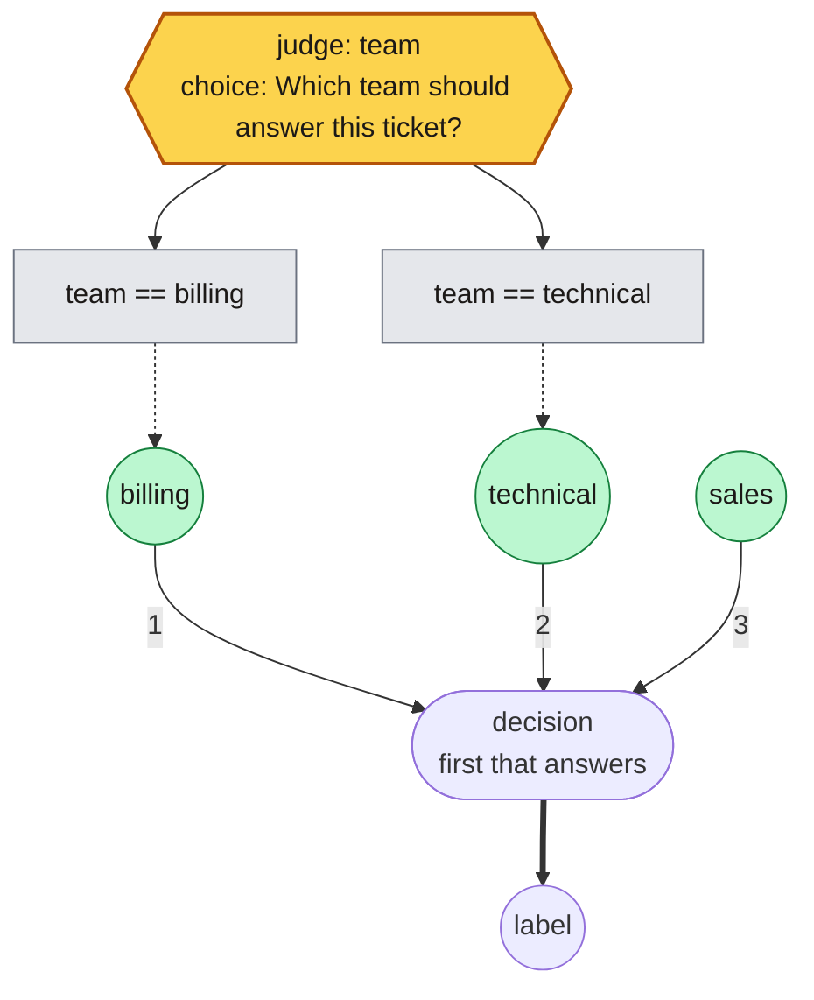
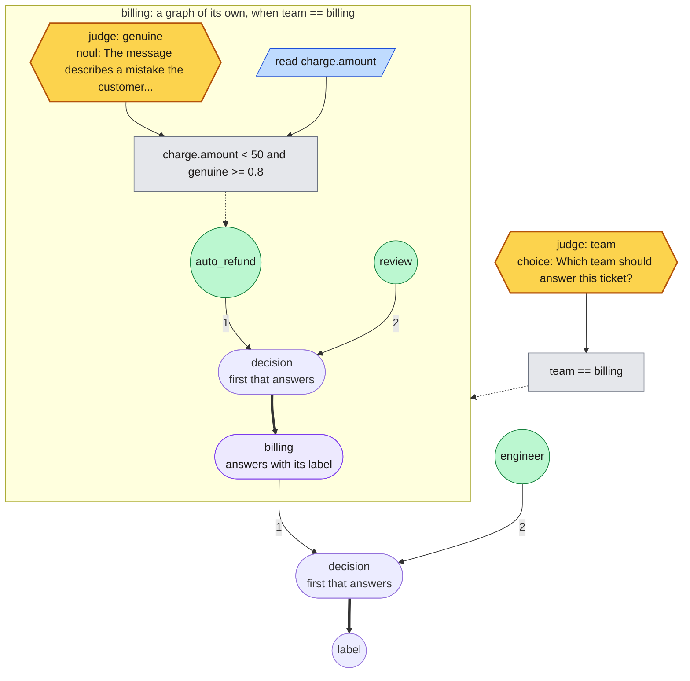

# Graph format

A graph (`plan.json`) has `nodes`, keyed by unique IDs, and `outputs`, keyed by
output names. Nodes connect by referencing each other's IDs; there is no separate
edge list, and JSON key order does not affect execution.

```json
{
  "nodes": {
    "department": {
      "type": "call",
      "question": {
        "type": "choice",
        "instructions": "Which department should handle this ticket?",
        "criteria": {
          "billing": "Charges, invoices, refunds.",
          "technical": "Product failures and troubleshooting.",
          "sales": "Purchases, pricing, demos."
        }
      },
      "inputs": {"ticket": {"type": "state"}}
    }
  },
  "outputs": {"label": {"type": "node", "node": "department"}}
}
```

Examples: [seed.json](../examples/support-routing/seed.json) (one call) and
[dag.json](../examples/support-routing/dag.json) (parallel calls, a conditional specialist, and joins).

## Nodes

| Node | Behavior |
| --- | --- |
| `call` | Ask a `choice`, `score`, or `noul` question about mapped `inputs`. An optional `briefing` is put first in what the judge is shown, ahead of the inputs: guidance on what to look for and how the labels differ, which a small judge takes from the state rather than from the question. An optional `temperature` (default 1, fitted by `rulesmith calibrate`) divides the judge's log-odds before they are read: above 1 tempers an overconfident judge, below 1 sharpens a timid one, and the answer itself never changes. An optional `judge` names another judge to ask, such as a larger model; where the graph runs, `--judge` gives each name a model. |
| `switch` | Map a categorical `source` value through exhaustive string `cases`. |
| `threshold` | Return `below` or `above`; a value `>= cutoff` selects `above`. Takes an optional `measured`, as `value` does. |
| `merge` | Build an object from mapped `inputs`, with no model call. |
| `coalesce` | After all `sources` settle, return the first available one in listed order. |
| `value` | Return a literal JSON `value`. An optional `measured` (`{"right", "decided", "examples"}`, set by `rulesmith calibrate`) records how many labeled examples the rule decided and how many rightly; a decision it makes is then as sure as `(right + 1) / (decided + 2)`. Written in rules as `when rating >= 4: yes calibrated 37/40 of 100`. |
| `read` | Take one value from the original input by `path`, declaring `bounds` (numbers) or `categories` (strings). A missing path, or a value outside the declared domain, skips the node. With `source`, it reads a field of that `extract` node instead, by the field's name as its one-step `path`. With `each`, a field-to-domain map in place of `bounds` or `categories`, it reads a list as its items' fields. |
| `quantify` | Test a list reading's items: `rule` is `any` or `all`, which hold only when some or every item meets `where`, or `count`, how many do. `where` is a condition over the items' field names; an item lacking a field fails a test on it. |
| `extract` | Ask a generative model to read its `inputs` into fields, following `instructions`. Its fields are the `read` nodes whose `source` it is, each with its domain; a field the model cannot fill within that domain is absent. Needs `--extractor-model` where the graph runs. |
| `confidence` | How sure the `choice` or `score` call named in `source` was, from 0 to 1. A `noul` answers with the probability itself, so it has no separate confidence, and validation refuses a `confidence` of a `noul`, or of anything but a call. |
| `sum` | A weighted sum of numeric `terms` (each `{"node", "weight"}`, weight 1 by default) plus a `constant`. Skipped when any term is skipped. Its range follows from its terms, so thresholds on it are checked like any other. |
| `graph` | Run another `plan`, embedded in this node, on the one value its `input` names (the whole input by default, or a node's value, or an object a `merge` built) and answer with its `output` (`label` by default). A unit of a larger map; see [Composing graphs](#composing-graphs). |
| `vote` | Settle two or more categorical `sources` into one value. `rule: majority` returns the value most of them gave, a tie going to the value the earlier source gave; `rule: agree` returns `same` (default `"yes"`) when every source gave the same value and `different` (default `"no"`) otherwise, and is skipped while any source is, since an opinion never given has not agreed. |

## Questions

| Type | Value | Limits |
| --- | --- | --- |
| `choice` | The selected category | 2–255 `criteria` options |
| `score` | Expected rubric position (not a probability) | 2–10 distinct `criteria` levels |
| `noul` | Probability of yes | — |

This is a subset of the [TypeSafe question schema](https://docs.typesafe.ai/primitives/choice).

## Inputs and outputs

`inputs` and `outputs` map names to sources:

| Source | JSON |
| --- | --- |
| Original input | `{"type": "state"}` |
| Constant | `{"type": "literal", "value": {"policy": "example"}}` |
| Earlier node value | `{"type": "node", "node": "eligible"}` |
| Full call answer | `{"type": "node", "node": "eligible", "view": "answer"}` |
| Optional value | `{"type": "node", "node": "eligible", "optional": true}` |

An input is a string, a JSON object, or an array. `read` walks a path into it, so
only a structured input can be read; a string can only be judged.

`view: "answer"` works only on call nodes and passes the whole validated answer,
including its probability distribution, instead of the scalar value.

## Conditions

Any node can have a `when` condition. It gates that node, not its dependencies.

```json
{"type": "compare", "node": "department", "op": "eq", "value": "billing"}
```

- `compare` supports `eq`, and `lt` / `ge` for numbers.
- `{"type": "relation", "node": "gain", "op": "ge", "other": "loss"}` compares two
  nodes instead of a node and a constant. Both must be numeric, or both
  categorical for `eq`, and it is false when either is skipped.
- Combine with `{"type": "all", "conditions": [...]}`, `{"type": "any", "conditions": [...]}`,
  and `{"type": "not", "condition": ...}`.
- `{"type": "present", "node": "id"}` tests whether a node ran.
- A comparison against a skipped node is false, so its negation is true.
- A named condition (`let armed = ...` in rules) is a `value` node holding `true`,
  guarded by that condition; rules test it with `present`.

## Execution

- Ready calls whose mapped inputs are identical are asked together in one request,
  so the judge reads the shared input once. The request's `state` is those inputs.
  Independent calls run concurrently, up to `max_workers` (default 4), and each
  node starts as soon as its own dependencies finish.
- A shared node runs once per execution, however many nodes use it.
- A node waits for all its data and condition dependencies, then runs or is skipped.
- A skipped required input skips its consumer; a skipped optional input is left out.
- `coalesce` skips only when every source skipped.
- A skipped optional output is omitted. A skipped required output leaves the
  decision undecided: the result has `label` and `decided_by` null and
  `undecided: "no_rule_applied"`. A decision that was made has `undecided: null`.
  A judge call that fails raises; that is a failure, not a decision.
- `ExecutionConfig(suppress=("node",))` forces the named nodes to skip. It exists
  to measure what a graph decides without them: `rulesmith ablate` and
  `rulesmith.ablate.effects` use it, and an ordinary run leaves it empty.

`DecisionProgram` returns a `dspy.Prediction` with `outputs`, `node_values`,
`answers`, `skipped`, per-call `calls` metadata, `models`, token totals, and,
when there is a `label` output, `label`, `decided_by` and `confidence`.

## Validation

```sh
uv run rulesmith validate task.json plan.json
```

Validation rejects cycles, unknown references, nodes that feed no output,
incompatible types, switches that miss a category, cutoffs outside the source
range, votes over sources with no categorical value, and unknown fields. For
classification, the `label` output must be a
required categorical value whose possible values are all task labels.

## Looking at a graph

Two commands for reading a graph rather than running it.

**`draw`** writes it as a Mermaid flowchart, which is the readable form for the
graphs rules cannot express: solid arrows carry values, a gray box is a
condition, and a dashed arrow leads from a condition to the rule it gates. `draw --json`
writes the same drawing as data, boxes and edges with each unit's boxes naming
the unit they sit in, for a canvas to lay out; from Python it is
`rulesmith.diagram.draw(plan)`, and `Drawing.to_dict()` is that JSON.

```sh
uv run rulesmith draw examples/support-routing/graph.rules
```

Output, as GitHub renders it:



Legend, the same in every drawing:

| | Drawn as | What it is | Cost |
| --- | --- | --- | --- |
|  | Amber hexagon, `judge` | A question to the model, Jev or Ruling, whichever `--backend` runs the graph; the graph itself names no backend | One model call |
|  | Blue slanted box, `read` | A value taken from the input by path | Free |
|  | Gray box | A condition: a test, not a step. Solid arrows bring it each value it reads; its dashed arrow leads to what it gates | Free |
|  | Green circle | The answer a rule gives when its condition holds | Free |
|  | Rounded box, `first that answers` | The rule list. Its arrows are numbered in the order the rules are tried; the first that answers decides | Free |
|  | Violet rounded box inside a framed box | A unit: another graph run on what it is handed, answering with one of its outputs. The frame holds the unit's own graph; the unit's gate and input arrive at the frame, and the frame's title says when the unit runs. Drawn closed, the unit is a double-edged box instead | Whatever its graph asks |
|  | Solid arrow | Carries a value | |
|  | Dashed arrow | Gates: leads from a condition to what fires when it holds | |
|  | Thick arrow | Leads to a graph output, or, inside a unit, to the violet box the unit answers through | |

Here the judge is named `team`, the name the rules test it by, so the gray box
`team == billing` reads as "the judge answered billing". `sales` has no
condition, so it answers whenever the two rules before it do not.

**`ablate`** answers what each reading, judgment and name is worth. It replays the
decisions the graph already made with one input switched off and counts how many
change, so it needs no fresh model calls beyond the first pass:

```sh
uv run rulesmith ablate task.json plan.json --split validation \
  --backend ruling --output runs/ablation.json
```

Output, for the graph built in the quickstart:

```json
{
  "states": 3,
  "effects": [
    {
      "node": "intent",
      "kind": "ask",
      "changed": 2,
      "share": 0.6667,
      "reason": ""
    }
  ]
}
```

The command reads its states from a task's examples. A Doom or chess task keeps
seeds instead, so for those, record the observations a graph saw and pass them to
`effects(plan, states)` in `rulesmith.ablate`. Run that way against the
best graph the chess league produced,
[league-best.json](../examples/chess/graphs/league-best.json), over 116 positions
from one game (a past run; the script that recorded the positions is not in the
repo):

```
reading                       changed   share   why not
capture.best_gain                  99     85%
hanging.worst                       9      8%
king.in_check                       3      3%
check.available                     1      1%
king.can_castle                     0      0%   present in 116 of 116 states and changes no decision
```

That last line is a rule the graph carries and never uses: `king.can_castle` is
there in every position, and the two rules above it fire first every time
castling is legal. A zero row means one of three things and the report says
which, because they are different problems: a path the state never has is a
typo, a rule an earlier one always beats is dead weight, and a threshold real
data never trips is a number chosen badly.

Search spends its budget rewriting whatever is in the graph, so rules that
cannot matter are rules the proposer wastes proposals on.

## Composing graphs

A `graph` node runs another graph as a unit: it is handed one value, its own
reads and judgments work on that value, and it answers with one of its outputs.
The boundary is typed like any edge, so a rule outside the unit may test its
answer only against the values the unit's graph can give, and `validate` says
so when it cannot. A unit is embedded as a `plan`, or named by `path`: a `.json`
or `.rules` file relative to the file naming it, which may name units of its own.
Every command loads a map's units before validating it, and from Python
`rulesmith.maps.load(path)` does the same, so what runs is always an ordinary
graph. [examples/ticket-handling/map.json](../examples/ticket-handling/map.json) routes a
ticket and hands billing tickets to
[units/billing.rules](../examples/ticket-handling/units/billing.rules):

```json
"billing": {
  "type": "graph",
  "path": "units/billing.rules",
  "when": {"type": "compare", "node": "team", "op": "eq", "value": "billing"}
}
```




The unit runs through the same engine on the same judge, gated like anything
else (here, only when the router answered billing), and its work rolls up into
the result under its name:

```sh
uv run rulesmith run examples/ticket-handling/map.json ticket.json --backend ruling
```

Output (trimmed), for a ticket about a duplicate $40 charge:

```text
{
  "label": "auto_refund",
  "decided_by": "billing.rule_1",
  "confidence": 0.867,
  "answers": {"team": {...}, "billing.genuine": {...}},
  "calls": {"team": {...}, "billing.genuine": {...}},
  ...
}
```

`decided_by` names the rule inside the unit that decided, and the confidence is
the least sure of every judgment on the way, the router's and the unit's. A
unit that could not answer answers nothing, and the rules after it decide.

`validate` on a map checks every hand-off across its files, refusing a rule
that tests a unit's answer against a value the unit never gives, and lists the
units it loaded under `units`. `draw` opens every unit, as above; `draw --closed`
draws each as one double-edged box, which is how a map of many units reads as
a map.

Units are the piece a map of many decisions is built from: a directory of unit
files and the maps that name them. A unit is searched in place against a task of
its own, with the rest of the map frozen. `unit-task` writes that task from the
map's: it runs the map over the map task's examples and keeps the cases handed
to the unit, as the unit was handed them, whose right answer is one the unit can
give. A case routed to the unit that needs another answer is the router's
mistake, which no change to the unit fixes:

```sh
uv run rulesmith unit-task support-task.json examples/ticket-handling/map.json --unit billing \
  --backend ruling --output billing-task.json
```

Then search the unit on it:

```sh
uv run rulesmith optimize billing-task.json examples/ticket-handling/map.json --unit billing \
  --backend ruling --reflection-model "$REFLECTION_MODEL" --output runs/billing
```

Search starts from the unit's graph, and the winner is placed back where the
unit was before anything is written: a winner that no longer gives a value the
map's rules test for is refused, naming the hand-off. Copy `runs/billing/plan.rules`
over the unit's file to adopt it. Add `--map-task support-task.json`, a task for
the whole map, and the map is scored on that task's validation examples with the
old unit and with the new before anything is written: a unit that is better on
its own task and worse for the map is refused, and the report records both
scores under `unit.map_validation`.

## Writing a graph by hand

1. Start from [seed.json](../examples/support-routing/seed.json) or [dag.json](../examples/support-routing/dag.json).
2. Give each node an ID and connect nodes through `inputs`, `source`, `sources`, or `when`.
3. Point a `label` output at the final decision.
4. Run `validate`, then use the graph directly or as a seed:
   `rulesmith optimize task.json plan.json ...`.
