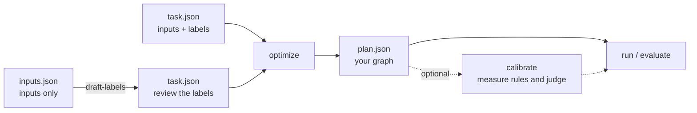
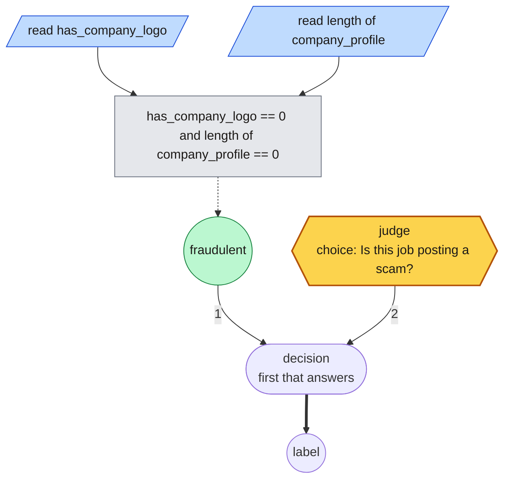

# Quickstart

The walk-through from a task file to a running graph, with every command's real
output; the README keeps the short form.

You need example inputs. Expected outputs (labels) are optional: if you don't
have them, a strong model drafts them for you to review.



## Installation

Requires Python 3.12–3.14.

```sh
pip install rulesmith
```

That covers classification tasks and every command except the games. The games
and the public benchmarks need packages the core leaves out, so they come as
extras:

| Extra | For | Adds |
| --- | --- | --- |
| `doom` | Doom tasks, `arena`, `record` | ViZDoom, NumPy, Pillow, ffmpeg |
| `chess` | Chess tasks | python-chess |
| `bench` | `python -m rulesmith.bench` | pyarrow, scikit-learn, Hugging Face Hub |

```sh
pip install 'rulesmith[doom,chess]'
```

The examples below run from a checkout with [uv](https://docs.astral.sh/uv/),
which installs every extra and the test tools:

```sh
git clone https://github.com/bradAGI/rulesmith.git
cd rulesmith
uv sync --locked
```

## From a task to a running graph

**1. Pick a judge.** The judge answers the graph's typed questions. Use
TypeSafe's hosted Jev, run Ruling on your own machine, or point rulesmith at any
OpenAI-compatible chat API; every command takes any of them, and the examples
below use Ruling.

<details>
<summary><b>Jev, hosted</b></summary>

Jev runs on TypeSafe's servers, so it works on any machine and answers many
requests at once. It needs an API key from [TypeSafe](https://typesafe.ai), and
its calls are billed:

```sh
export TYPESAFE_API_KEY=<your key>
```

Jev is the default backend, so with the key set, leave `--backend ruling` off
the commands below. The model defaults to `jev-latest`;
pass `--model` with a pinned version for results you want to reproduce.

</details>

<details open>
<summary><b>Ruling, local</b></summary>

[Ruling](https://github.com/bradAGI/ruling) runs on an Apple Silicon Mac and
needs no account. In a separate terminal:

```sh
pip install ruling     # or: uv tool install ruling; add [vision] to ask about images
ruling serve
```

Leave that server running and run the remaining commands from `rulesmith` in
your original terminal. Ruling downloads its model on first use. On an NVIDIA GPU it
answers the same requests through vLLM instead of MLX; see
[Ruling's reference](https://github.com/bradAGI/ruling/blob/main/docs/reference.md#on-nvidia-vllm).

Ruling can also fine-tune the judge on your labeled examples and serve the
result: `rulesmith tune task.json --output tuning` writes the records its
trainer reads, with the test split held out, runs the training from a Ruling
checkout beside yours (`git clone https://github.com/bradAGI/ruling.git ../ruling`,
then `uv sync --no-dev --directory ../ruling`), and prints the line that
serves the adapter. The graph does not
know or care that its judge is tuned, and the
[benchmarks](benchmarks.md#a-judge-tuned-on-the-same-examples) show what a tune
on a hundred examples is worth: it lifts the judge, and the graph on top of it
gains most where the input has fields.

</details>

<details>
<summary><b>Clef-flash, on an NVIDIA GPU or a Mac</b></summary>

Cloudflare's 9B decision model answers the same typed questions, needs no key, and
scored above the tuned 4B judge on both datasets it was [measured on](benchmarks.md#escalating-to-a-larger-judge).
On Linux with a GPU of about 20 GB (an L4, A10G, A100 or larger):

```sh
pip install 'rulesmith[clef]'
rulesmith clef-serve --port 8000
```

Then add `--backend clef --max-workers 1` to the commands below. On a Mac, its 4-bit
MLX port is lighter and faster; both are in [backends](cli.md#backends).

</details>

<details>
<summary><b>Any OpenAI-compatible API</b></summary>

The `openai` backend asks a chat model each question with its options lettered
A, B, C, and reads the answer's probabilities from the log-probabilities of
that one-letter reply. It works with OpenAI itself or any server that speaks
`/v1/chat/completions` and returns `logprobs`, such as a local `mlx_lm.server`
or vLLM. Reasoning models, and some providers, return no log-probabilities, and
rulesmith says so rather than guessing.

```sh
export OPENAI_API_KEY=<your key>
```

Then use `--backend openai` in place of `--backend ruling`. The
model defaults to `gpt-4.1`, the strongest OpenAI model that still returns
log-probabilities (the GPT-6 models and most GPT-5 ones do not); pass `--model` for another, and `--base-url`
(or `OPENAI_BASE_URL`) for a server other than OpenAI's. The proposer below
reads the same `OPENAI_API_KEY`; a local proposer server accepts any key, so
keep your real one set instead of the placeholder step 2 exports. Each question
is a separate request, billed as the provider bills it.

A local model works the same way, with no key. Qwen3 thinks before it answers
unless told not to, so turn that off:

```sh
uv run --no-project --with mlx-lm==0.32.0 mlx_lm.server \
  --model mlx-community/Qwen3-0.6B-4bit --port 8091 \
  --chat-template-args '{"enable_thinking": false}'
uv run rulesmith run graph.rules input.json --backend openai \
  --base-url http://127.0.0.1:8091/v1 --model mlx-community/Qwen3-0.6B-4bit
```

</details>

**2. Configure a proposer**, the model that writes graphs, using a
[DSPy model identifier](https://dspy.ai/learn/programming/language_models/).
The example below assumes you have separately started an OpenAI-compatible
model server at `http://127.0.0.1:8080/v1`. Replace `<served-model-id>` with its
model ID; Ruling provides the judge, not this generative endpoint:

```sh
export REFLECTION_MODEL="openai/<served-model-id>"
export REFLECTION_BASE_URL=http://127.0.0.1:8080/v1
export OPENAI_API_KEY=local-no-auth
```

**3. Describe the task.** Start with the complete labeled sample, or write
`task.json` in this shape:

```sh
cp examples/support-routing/task.json task.json
```

```json
{
  "description": "Route each support ticket to billing, technical, or sales.",
  "labels": ["billing", "technical", "sales"],
  "train": [{"id": "t1", "state": "I was charged twice.", "label": "billing"}],
  "validation": [{"id": "v1", "state": "The app crashes.", "label": "technical"}],
  "test": [{"id": "e1", "state": "Can I get a price quote?", "label": "sales"}]
}
```

`train` drives proposals, `validation` picks the winner, and `test` is scored once at the end.

No labels yet? `rulesmith draft-labels` has a strong model draft them for you
to review. Inputs with structure, mistakes that cost more than others, more than
one right answer, or a grader instead of labels: see [Tasks](tasks.md).

**4. Build the graph.**

```sh
uv run rulesmith optimize task.json \
  --backend ruling \
  --reflection-model "$REFLECTION_MODEL" \
  --reflection-base-url "$REFLECTION_BASE_URL" \
  --output runs/my-task
```

Output (trimmed; captured with a hosted proposer, `REFLECTION_MODEL=openrouter/qwen/qwen3.8-27b`):

```text
Iteration 0: Base program full valset score: 0.3333333333333333 over 3 / 3 examples
Iteration 1: Proposed new text for readings: ask intent = "Route each support ticket to billing, technical, or sales based on its primary request. ..."
...
{
  "resolved_models": ["mlx-community/Qwen3.5-4B-4bit"],
  ...
  "seed_validation_score": 0.3333333333333333,
  "validation_score": 1.0,
  "improvement_p": 0.25,
  "kept_seed": false,
  "candidates": 2,
  "reflection_calls": 3,
  "metric_calls": 102,
  "backend": "ruling",
  "reflection_model": "openrouter/qwen/qwen3.8-27b",
  "scored_by": "labels"
}
```

This writes `runs/my-task/plan.json` (the graph), `plan.rules` (the same
graph as the rules search wrote, which you can edit, and which every command
accepts in place of the JSON) and `report.json` (scores). Compare
`validation_score` with `seed_validation_score`. Search checkpoints as it goes:
an interrupted run continues with `--resume`, and a larger `--max-metric-calls`
on a resumed run searches further.

**5. Evaluate and run it.** The proposer is not needed from here on.

```sh
uv run rulesmith evaluate task.json runs/my-task/plan.json \
  --backend ruling --split test --output runs/my-task/test.json

uv run rulesmith run runs/my-task/plan.json examples/support-routing/input.json \
  --backend ruling
```

Output (trimmed):

```text
{
  "score": 1.0,
  "output": "runs/my-task/test.json"
}
{
  "outputs": {"label": "billing"},
  ...
  "answers": {
    "intent": {
      "type": "choice",
      "value": "billing",
      "probabilities": {"billing": 0.991, "technical": 0.009, "sales": 0.00007},
      "confidence": 0.987
    }
  },
  "skipped": ["rule_2", "rule_3"],
  ...
  "input_tokens": 166,
  "output_tokens": 0,
  "label": "billing",
  "decided_by": "rule_1",
  "confidence": 0.991
}
```

## Keeping a decision

Keep each decision in a folder of its own, in git, the way [examples](../examples) does: the
task it was measured on (`task.json`), the graph as it runs (`graph.rules`, or `map.json` for a
map), and its score on the test split (`evaluation.json`, from `rulesmith evaluate`). A change
to the rules is then a diff a reviewer can read beside the scorecard it moved, and rerunning
`evaluate` reproduces the number. Rule counts and cutoffs hold for the judge they were measured
on, which the scorecard names; after changing the judge, run `calibrate` and `evaluate` again
and commit both.

## Teaching the judge

A Ruling judge can learn the task it is asked about. Start Ruling with a ledger
(`RULING_LEDGER=ledger.sqlite`) and search with `--teach-judge`:

```sh
rulesmith optimize task.json --backend ruling --teach-judge ...
```

Every time the judge answers a label question about a train example (a choice
whose options are the task's labels), the example's label is reported to Ruling
as that decision's outcome. Ruling's `retrain` then fine-tunes the judge on
those decisions and serves the result when it scores better; see
[Learn from your own traffic](https://github.com/bradAGI/ruling/blob/main/docs/reference.md#learn-from-your-own-traffic).
Validation and test labels are never sent: the search is measured on them, and
a judge that had seen them would make its score meaningless. An example that
accepts several labels teaches nothing, since none of them is the one right
answer. Judges named with `--judge` are not taught.

## What search writes

Search writes rules, not prompts. On the [job-postings benchmark](benchmarks.md)
it found this program from 100 labeled postings:

```
read has_company_logo in [0, 1]
read length of company_profile in [0, 10000]
when has_company_logo == 0 and length of company_profile == 0: fraudulent
always: ask "Is this job posting a scam?" [fraudulent: "fraudulent"] [genuine: "genuine"]
```

Drawn with `rulesmith draw` (the [legend](graphs.md#looking-at-a-graph)):



Rule 1 reads two fields and, when the posting has no logo and an empty company
profile, answers `fraudulent` without calling any model. Only when it declines
does rule 2 ask the judge (Jev or Ruling), which it did on 58% of test postings.
The question search wrote is longer than shown here; the rules are as found.

Rules compile to a validated graph that the runtime executes, and read back as
the rules they came from: `optimize` saves both, and a `.rules` file runs
anywhere a `plan.json` does, so you can edit what search wrote. The language,
with what a judgment can be and how sure a rule is, is in [Rules](rules.md).
A judgment can be asked of a larger judge only when the small one is unsure,
a generative model can read fields out of free text for rules to test, and a
rule can test any or all of a list's items, or count them. These run and are
tested; of them only escalation is measured so far: on TREC, a tuned 4B
escalating to Clef-flash sent 9% of questions up and gained half the gap to
Clef-flash alone, as the [benchmarks](benchmarks.md#escalating-to-a-larger-judge)
show, while extraction and lists are not yet in the benchmarks.
Graphs compose: a decision can hand a case to another graph's unit, and many
decisions become one map, validated across its hand-offs and searched a unit
at a time; the first one is in [Maps](maps.md).
